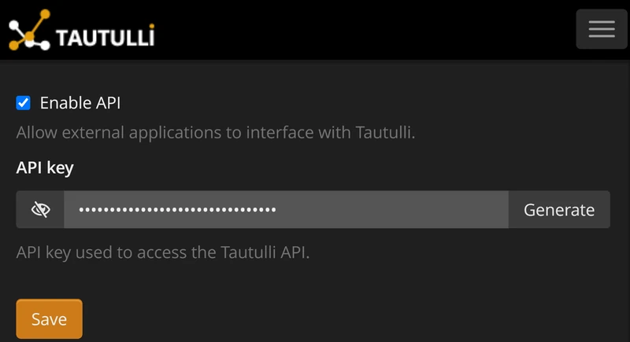

<div align="center">


[](https://github.com/brah/plex-bot/actions/workflows/ci.yml)

[](LICENSE)
[](#deployment)

**[Setup](#setup)** · **[Configuration](#configuration)** · **[Commands](#commands)** · **[Deployment](#deployment)** · **[Troubleshooting](#troubleshooting)** · **[Changelog](CHANGELOG.md)**

</div>

A Discord bot for your Plex server. It reads [Tautulli](https://github.com/Tautulli/Tautulli) and answers with slash commands: who's watching, what's popular, who watches most, charts, recommendations and library lookups.

<table>
<tr>
<td></td>
<td></td>
</tr>
</table>

<sub>Screenshots are for reference only and may not match the current version exactly.</sub>

<details>
<summary><b>More screenshots</b></summary>

<table>
<tr>
<td></td>
<td></td>
</tr>
<tr>
<td></td>
<td></td>
</tr>
<tr>
<td></td>
<td></td>
</tr>
<tr>
<td></td>
<td></td>
</tr>
<tr>
<td></td>
<td></td>
</tr>
<tr>
<td></td>
<td></td>
</tr>
<tr>
<td></td>
<td></td>
</tr>
<tr>
<td></td>
<td></td>
</tr>
</table>

</details>

## Setup

You need a working Tautulli, a Discord server you can add bots to, and either Docker or Python 3.12+. qBittorrent is optional.

**Discord.** In the [Developer Portal](https://discord.com/developers/applications), create an application. Under **Bot**, copy the token, turn on **Server Members Intent**, and turn off **Public Bot**. Then invite it, using your application ID:

```text
https://discord.com/oauth2/authorize?client_id=YOUR_APP_ID&scope=bot+applications.commands&permissions=268487680
```

**Top-watcher roles (optional).** The bot can give your three biggest watchers a role each, such as Plex King, Plex Two and Plex Three. Create the roles, then set their IDs as `discord.top_role_id`, `second_role_id` and `third_role_id` (with Developer Mode on under **User Settings → Advanced**, right-click a role and choose **Copy Role ID**).

Discord only lets a bot give out roles that sit below its own highest role. Usually that's the role named after the bot, which Discord created when you invited it. In **Server Settings → Roles**, drag the bot's role above all three:

```text
plex-bot      ← the bot's role
Plex King
Plex Two
Plex Three
...your other roles
```

Only the bot has its role, so putting it at the top changes nothing for anyone else. The three roles still sit above all your other roles, so their colours still show on the winners' names. The roles move to the new top three whenever someone runs `/plex top` for the default 7 days.

**Tautulli.** The bot needs Tautulli's API key and address.

1. In Tautulli, open **Settings** from the menu at the top right, choose **Web Interface**, and scroll down to **API**.
2. Tick **Enable API** if it isn't already.
3. Click the eye icon to show the key, and copy it. If the field is empty, press **Generate**.
4. Press **Save**.



Keep the key private: it gives full control of Tautulli. Pressing **Generate** again replaces it, and the bot stops working until you give it the new one.

The address is where Tautulli runs, as `host:port`, such as `192.168.1.10:8181` (8181 is Tautulli's default port). If you reach Tautulli through a reverse proxy over HTTPS, use its hostname, such as `tautulli.example.com`, and set `tautulli.use_https` to `true`. Running the bot in Docker? See [Docker Compose](#docker-compose) for the address to use from inside a container.

**Run it.** With Docker, follow [Docker Compose](#docker-compose). Without Docker:

```bash
git clone https://github.com/brah/plex-bot.git && cd plex-bot
python -m venv .venv && source .venv/bin/activate   # Windows: .venv\Scripts\activate
pip install -r requirements.txt
cp config.example.json config.json                   # fill in token, tautulli and server_id
python -m plexbot
```

Type `/plex` in Discord. To keep it running, see [systemd](#systemd).

## Configuration

You can set each option in `config.json` (start from [`config.example.json`](config.example.json)), as an environment variable, or both. Environment variables are the easy way with Docker: put them in `.env` (see [`.env.example`](.env.example)). If an option is set in both places, the environment variable wins. Anything you leave out uses a default.

| `config.json` | Environment variable | What it does |
| --- | --- | --- |
| `core.token` | `PLEXBOT_CORE_TOKEN` | Discord bot token |
| `tautulli.ip` | `PLEXBOT_TAUTULLI_IP` | Tautulli's address, as `host:port` |
| `tautulli.apikey` | `PLEXBOT_TAUTULLI_APIKEY` | Tautulli's API key |
| `tautulli.use_https` | `PLEXBOT_TAUTULLI_USE_HTTPS` | `true` to connect to Tautulli over HTTPS |
| `discord.server_id` | `PLEXBOT_DISCORD_SERVER_ID` | Your server's ID. Commands appear there at once; blank registers them globally, which takes up to an hour |
| `discord.admin_ids` | `PLEXBOT_DISCORD_ADMIN_IDS` | Users or roles who are bot admins, besides the server's administrators |
| `discord.top_role_id` | `PLEXBOT_DISCORD_TOP_ROLE_ID` | Role for the top watcher |
| `discord.second_role_id` | `PLEXBOT_DISCORD_SECOND_ROLE_ID` | Role for the second |
| `discord.third_role_id` | `PLEXBOT_DISCORD_THIRD_ROLE_ID` | Role for the third |
| `discord.stream_manager_ids` | `PLEXBOT_DISCORD_STREAM_MANAGER_IDS` | Users or roles who may stop streams |
| `discord.show_recent_viewers` | `PLEXBOT_DISCORD_SHOW_RECENT_VIEWERS` | Show the last few viewers when nobody's watching (public, so off by default) |
| `qbittorrent.ip`, `port` | `PLEXBOT_QBITTORRENT_IP`, `PLEXBOT_QBITTORRENT_PORT` | qBittorrent Web UI address, for `/plex downloading` |
| `qbittorrent.username`, `password` | `PLEXBOT_QBITTORRENT_USERNAME`, `PLEXBOT_QBITTORRENT_PASSWORD` | qBittorrent Web UI login |
| `core.legacy_text_commands` | `PLEXBOT_CORE_LEGACY_TEXT_COMMANDS` | Point old text commands like `plex status` at their slash version. Needs **Message Content Intent**, so it's off; `@PlexBot top` works either way |
| `core.log_level` | `PLEXBOT_CORE_LOG_LEVEL` | `DEBUG` to `ERROR` |

In an environment variable, write a list of IDs with commas (`PLEXBOT_DISCORD_ADMIN_IDS=123,456`) and an on/off option as `true` or `false`.

Appearance lives in `ui` (embed colour), `charts` (size and `dpi`) and `defaults`. These have environment variables too, named the same way: `charts.dpi` is `PLEXBOT_CHARTS_DPI`. To swap in your own mascot art, see [`assets/mascot/`](assets/mascot/README.md).

**Keep the bot private.** Leave `server_id` set and **Public Bot** off. Otherwise anyone could add the bot to their own server and browse your Plex activity. Admins are the administrators of `server_id` plus `admin_ids`; with `server_id` blank, only `admin_ids` counts. Discord only shows `/plexadmin` to administrators; let others see it under **Server Settings → Integrations**.

## Commands

Everything is under `/plex`, plus `/plexadmin` for admins.

| Command | |
| --- | --- |
| `/plex status` | Server health, library size and plex.tv status |
| `/plex watchers` | Current streams; stream managers can stop them |
| `/plex movie`, `/plex tv` | Look up a title: details, cast, who's watched it |
| `/plex random` | A random pick, optionally by type and genre |
| `/plex recent` | Recently added |
| `/plex recommend` | Unwatched picks from someone's favourite genres |
| `/plex top` | Top watchers; also hands out the top-three roles |
| `/plex stats` | Server stats across five pages |
| `/plex hot` | Trending titles, binges and new hits |
| `/plex history` | Recent plays, everyone's or one person's |
| `/plex shows` | Top TV watchers of all time |
| `/plex chart` | Charts by day, hour, weekday, viewer, show or movie |
| `/plex downloading` | qBittorrent progress |
| `/plex help` | What the bot can do |
| `/plexadmin users`, `link`, `unlink`, `ignore` | Link Plex users to Discord members, or hide them from stats |
| `/plexadmin cache`, `logs` | The media cache and recent logs |

Linking matters: names, avatars, roles and `/plex recommend` need it.

## Deployment

Run exactly one instance, near Tautulli. It needs no open ports.

### Docker Compose

The image is `ghcr.io/brah/plex-bot`, built for standard PCs and ARM boards such as a Raspberry Pi. Do the Discord and Tautulli steps from [Setup](#setup) first.

**1. Add the bot to your Compose file**, the one Tautulli is in if you run it in Docker:

```yaml
services:
  plexbot:
    image: ghcr.io/brah/plex-bot:latest
    container_name: plexbot
    restart: unless-stopped
    environment:
      PLEXBOT_CORE_TOKEN: "your-discord-bot-token"
      PLEXBOT_TAUTULLI_IP: "tautulli:8181"
      PLEXBOT_TAUTULLI_APIKEY: "your-tautulli-api-key"
      PLEXBOT_DISCORD_SERVER_ID: "your-discord-server-id"
    volumes:
      - plexbot-data:/data

volumes:
  plexbot-data:
```

If your file already has a top-level `volumes:` section, add `plexbot-data:` to it rather than starting a second one.

**2. Point it at Tautulli.** `PLEXBOT_TAUTULLI_IP` is Tautulli's address as the bot's container sees it, where `localhost` means the bot's own container:

| Where Tautulli runs | `PLEXBOT_TAUTULLI_IP` |
| --- | --- |
| In the same Compose file | Its service name, like `tautulli:8181` |
| In another Compose file, or on another machine | That machine's LAN address, like `192.168.1.10:8181` |
| On the same machine, outside Docker | `host.docker.internal:8181`, and add `extra_hosts: ["host.docker.internal:host-gateway"]` to the bot's service |

**3. Start it:**

```bash
docker compose up -d plexbot
docker compose logs -f plexbot   # "Logged in as ..." means it's working; Ctrl+C stops following
```

Then type `/plex` in Discord.

**More settings.** Every option in [Configuration](#configuration) goes under `environment:` as its `PLEXBOT_...` variable. To keep your token out of the Compose file, put the variables in their own file instead, starting from [`.env.example`](.env.example), and load it with `env_file: plexbot.env` under the bot's service.

**Your data.** The bot keeps its user links (`map.json`), media cache and `plexbot.log` in `/data`, and the `plexbot-data` volume keeps them across updates. To use a folder instead, such as `./plexbot:/data`, create it first and hand it to user 1000, which the bot runs as: `mkdir -p plexbot && sudo chown 1000:1000 plexbot`. A folder Docker creates for you belongs to root, and the bot stops with a `PermissionError`.

**Updating.**

| To | Run |
| --- | --- |
| Update | `docker compose pull plexbot && docker compose up -d plexbot` |
| Apply changed settings | `docker compose up -d plexbot` |
| Stop | `docker compose stop plexbot` |
| Back up user links | `docker compose cp plexbot:/data/map.json map.json` |

`latest` moves with every release. To choose when you upgrade, pin a version instead: `ghcr.io/brah/plex-bot:1` takes new features and fixes but never a change that needs you to edit your setup, and `ghcr.io/brah/plex-bot:1.0.0` never moves. [CHANGELOG.md](CHANGELOG.md) says what each release changed.

**No Compose file yet?** In an empty folder, download the ready-made one and its settings file, fill in `.env`, then run `docker compose up -d`. It needs Compose 2.24 or newer.

```bash
curl -O https://raw.githubusercontent.com/brah/plex-bot/main/docker-compose.yml
curl -o .env https://raw.githubusercontent.com/brah/plex-bot/main/.env.example
```

**Prefer `config.json`?** Download [`config.example.json`](config.example.json) as `config.json`, fill it in, and mount it with `./config.json:/data/config.json:ro` under the bot's `volumes:`. Environment variables still win over it.

**Building from source?** Clone the repo, use `build: .` in place of `image:`, then run `docker compose up -d --build plexbot`.

### systemd

Install into a venv, edit and copy [`deploy/plexbot.service`](deploy/plexbot.service) to `/etc/systemd/system/`, then `sudo systemctl enable --now plexbot`.

To update: `git pull`, `pip install -r requirements.txt`, then `sudo systemctl restart plexbot`. `git pull` follows `main`, which can be ahead of the latest release. To stay on releases instead, update with `git fetch --tags && git checkout v1.0.0` (the version you want) in place of `git pull`; `git checkout main` goes back. [CHANGELOG.md](CHANGELOG.md) says what changed in each release.

## Troubleshooting

- **`PrivilegedIntentsRequired`**: turn on **Server Members Intent**.
- **No slash commands**: set `server_id`, and check the invite included `applications.commands`.
- **"Couldn't reach Tautulli"**: check `tautulli.ip` and the key.
- **No roles handed out**: set all three role IDs, link the winners to their Discord accounts with `/plexadmin link`, and check the bot's role sits above all three in **Server Settings → Roles**. When it doesn't, the log says `Bot role hierarchy too low to manage top user roles`.
- **`PermissionError: [Errno 13] Permission denied: '/data/plexbot.log'`**: the folder mounted at `/data` isn't writable by user 1000, which the bot runs as. Run `sudo chown -R 1000:1000` on that folder.
- **No TV sizes on `/plex status`**: run **Calculate Total File Sizes** on the library in Tautulli.
- **`can't open file '.../plexbot.py'`**, or the systemd service won't start: the bot runs with `python -m plexbot` from the repo folder. Match `ExecStart=` and `WorkingDirectory=` to [`deploy/plexbot.service`](deploy/plexbot.service), then `sudo systemctl daemon-reload && sudo systemctl restart plexbot`.

Logs go to `plexbot.log`; admins can also fetch them with `/plexadmin logs`, with secrets redacted.

## Development

```bash
pip install -r requirements.txt pytest "ruff==0.17.0"
pytest -q && ruff check .
```

Tests need neither Discord nor Tautulli. [CONTRIBUTING.md](CONTRIBUTING.md) explains how the code is laid out and the rules for changes.

## A note on AI

This is a hobby project, so don't be surprised to find AI in the commits. Use whatever tools help you build and contribute.

## License

[MIT](LICENSE)
